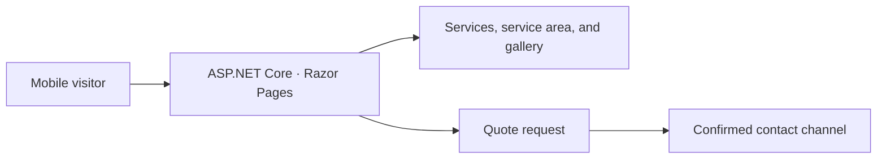

# Mão na Obra

[Português](README.md) · **English**

**A landing page for people looking for a builder and a quote in Portugal.**

I created the prototype for my uncle, who works in construction in Portugal. The redesign starts with the questions a customer needs answered before making contact: what he does, where he works, and how to request a quote.

**Repository status:** a React and TypeScript prototype started in 2022. The ASP.NET Core version and deployment are planned.

## Run the React prototype

With Node.js 22 and npm, install the dependencies and start the development server.

```bash
npm ci
npm start
```

Open `http://localhost:3000`. Run `npm run build` to build the prototype. The .NET setup will be documented with the first working workflow.

## What the new page should do

- **Explain the services.** Describe the work the builder accepts, in European Portuguese, with clear copy and mobile-friendly navigation.
- **Show the service area.** List the confirmed locality and areas served.
- **Show real work.** Use approved photos, with context about the work and alternative text.
- **Make it easy to request a quote.** Offer a confirmed business contact and a short path to share the location and type of work.

## Proposed architecture



| Choice | Rationale |
| --- | --- |
| **C# and ASP.NET Core Razor Pages on .NET 10 LTS** | The site can serve server-rendered HTML. The same application handles service pages and can validate a quote request if needed. [Microsoft .NET lifecycle](https://learn.microsoft.com/en-us/lifecycle/products/microsoft-net-and-net-core) |
| **Responsive HTML and CSS** | The core journey is to read, review completed work, and get in touch. Keyboard navigation, sized images, and a mobile layout are part of the delivery. |
| **Direct contact in the first release** | An approved contact channel lets visitors request quotes without accounts or a customer database. If useful, a form can prepare a message for the visitor to review before sending. |
| **GitHub Actions and Azure App Service** | The pipeline can check the build, test routes, and deploy the .NET application. The demo can use an Azure hostname while a custom domain and hosting costs are assessed. [Deployment guide](https://learn.microsoft.com/en-us/azure/app-service/quickstart-dotnetcore) |

## Release criteria

1. Confirm the service area, services, business name, and contact channel with the builder.
2. Review the mobile and keyboard experience. Verify links, images, European Portuguese copy, and the quote journey.
3. Verify the build, routes, metadata, and HTTPS on the published site.
4. Document the implementation, the reasons for the stack choice, and the live URL. Use screenshots from the published site in the portfolio.

## Postman, Insomnia, and verification

Start the prototype and import the [Mão na Obra collection](docs/postman.collection.json) into Postman or Insomnia to check the HTML response. Run `npm run build` and open the page in a browser. Check that the home route loads and that keyboard navigation works on the existing controls.
