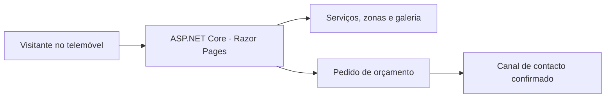

# Mão na Obra

**Português** · [English](README.en.md)

[](https://github.com/acamilateixeira/maonaobra/actions/workflows/ci.yml)

**Uma montra para quem precisa de encontrar um pedreiro e pedir um orçamento em Portugal.**

Criei o protótipo para o meu tio, que trabalha na construção em Portugal. A nova página parte das perguntas que um cliente precisa de esclarecer antes do primeiro contacto: que serviços presta, em que zona trabalha e como pode pedir orçamento.

**Estado do repositório:** protótipo em React e TypeScript iniciado em 2022. A versão ASP.NET Core e a publicação estão em planejamento.

## Experimentar o protótipo React

Com Node.js 22 e npm, instale as dependências e inicie o servidor de desenvolvimento.

```bash
npm ci
npm start
```

Abra `http://localhost:3000`. O comando `npm run build` prepara o build do protótipo. Os comandos da versão .NET serão acrescentados quando o primeiro fluxo estiver implementado.

## O que a nova página deve resolver

- **Entender os serviços.** Apresentar os trabalhos que o profissional aceita, em português de Portugal, com texto claro e navegação simples no telemóvel.
- **Conferir a zona de atendimento.** Mostrar a localidade e as zonas confirmadas pelo profissional.
- **Ver trabalhos reais.** Incluir fotografias autorizadas, com contexto sobre o serviço realizado e texto alternativo.
- **Pedir orçamento.** Oferecer um contacto comercial confirmado, com um percurso curto para dizer a localidade e o tipo de trabalho.

## Arquitetura proposta



| Escolha | Motivo |
| --- | --- |
| **C# e ASP.NET Core Razor Pages em .NET 10 LTS** | A página pode entregar HTML renderizado no servidor. A mesma aplicação cuida das páginas de serviços e da validação de um eventual pedido de orçamento. [Ciclo de suporte do .NET](https://learn.microsoft.com/en-us/lifecycle/products/microsoft-net-and-net-core) |
| **HTML e CSS responsivos** | O percurso principal é ler, ver trabalhos e contactar. Navegação por teclado, imagens com dimensões definidas e um layout que funciona no telemóvel fazem parte da entrega. |
| **Contacto direto na primeira versão** | Um contacto aprovado permite pedir orçamento sem criar contas nem manter um cadastro de clientes. Se for útil, um formulário pode preparar uma mensagem que a pessoa confere antes de enviar. |
| **GitHub Actions e Azure App Service** | O pipeline pode verificar o build, testar as rotas e publicar a aplicação .NET. O ambiente de demonstração pode usar o endereço da Azure enquanto domínio e custo são avaliados. [Guia de deploy](https://learn.microsoft.com/en-us/azure/app-service/quickstart-dotnetcore) |

## Critérios para publicar

1. Confirmar com o profissional a zona de atendimento, a lista de serviços, o nome comercial e o canal de contacto.
2. Conferir a página no telemóvel e por teclado. Validar links, imagens, texto em português de Portugal e o percurso de pedido de orçamento.
3. Verificar build, rotas, metadados e HTTPS na versão publicada.
4. Documentar o código, a decisão pela nova stack e a URL real. Usar capturas da versão publicada para apresentar o projeto no portfólio.

## Postman, Insomnia e verificação

Inicie o protótipo e importe a [coleção Mão na Obra](docs/postman.collection.json) no Postman ou Insomnia para verificar a resposta HTML. Rode `npm run build` e abra a página no navegador. Confira se a rota inicial carrega e se a navegação por teclado funciona nos elementos já presentes.
